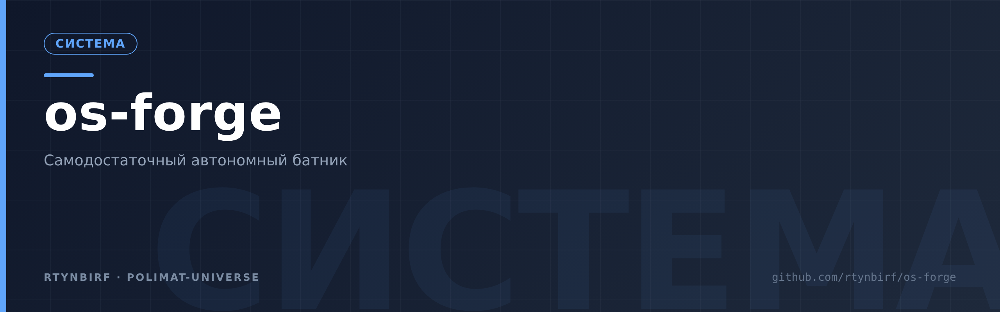
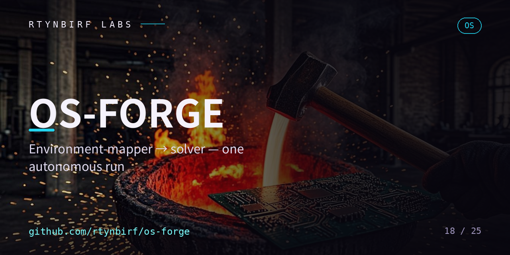

<div align="center">
  
</div>

# OS-FORGE v0.1.1

<p align="center"></p>


**БАТНИК — самодостаточный автономный алгоритм:** при активации распознаёт
свою среду (железо + ОС, карта по фактам), решает, по какому алгоритму и с
какими ядрами действовать, идёт в сеть в репозиторий пунктов и собирает
актуальную на момент запуска ОС, выводя полный готовый ISO в место,
указанное запускающим, — с пунктами, оптимально настроенными под его
конкретную конфигурацию.

> Канон: карта=территория · пункт фиксируется с «почему только так» ·
> опасное пассивно · честные русские отказы · журнал в момент такта.

**v0.1.1 (2026-10-29):** глубокий обход ВСЕХ 13 реп Хозяина с токеном — велосипеда нет,
всё готовое взято: манифест-практика PHOENIX вжита в оба ядра (`МАНИФЕСТ.json`
рядом с ISO — SHA256, размер, дата, карта, параметры). Доноры каждой части:
`docs/КАРТА-ИСТОЧНИКОВ.md`.

## Быстрый старт

### Windows (БАТНИК)
1. Скачай репозиторий (или хотя бы `ЗАПУСК.bat`).
2. Правь ТОЛЬКО блок КОНФИГ в начале батника: `VYHOD` (куда ISO),
   `CEL_OSI` (auto|win11), редакция/выпуск/язык, учётка автоустановки.
3. Запусти `ЗАПУСК.bat` двойным кликом (права администратора НЕ нужны).
4. Сначала проверь план: поставь `DRY=1`, потом собирай: `DRY=0`.
5. Готовый ISO: `Desktop\OS-FORGE\OSFORGE_win11_*_x64.iso`.
   Запись на флешку: Rufus, режим DD. Загрузка — UEFI.

### Linux (близнец)
```bash
chmod +x запуск.sh
./запуск.sh сухой-прогон          # план без исполнения
DRY=0 ./запуск.sh всё             # карта → решение → сборка → ISO
# нужно: xorriso + isolinux (sudo apt-get install -y xorriso isolinux)
```
Готовый ISO: `output/OSFORGE_debian_amd64.iso`.

## Что делает батник (7 стадий)

| Стадия | Windows | Linux |
|---|---|---|
| АКТИВАЦИЯ | curl/powershell на месте? | xorriso/isolinux на месте? |
| КАРТА | CIM/WMI: CPU, RAM, GPU, диски, сеть, прошивка, локаль | /proc, lspci, df, /sys/firmware/efi |
| РЕШЕНИЕ | ветка win11 по карте+КОНФИГУ | ветка debian по карте |
| СЕТЬ | ядра+каталог по тегу v0.1, Fido по хэш-пину → официальная ссылка Microsoft | официальный cdimage.debian.org + SHA256SUMS |
| СБОРКА | Mount-DiskImage → autounattend+драйверы+пункты → IMAPI2 (UDF, EFI) | preseed в isolinux И grub → xorriso isohybrid |
| АРТЕФАКТ | ISO + SHA256 в ВЫХОД | ISO + SHA256 в output |
| ЖУРНАЛ | ЖУРНАЛ.txt в момент такта | ЖУРНАЛ.txt в момент такта |

## Закон пунктов (сердце репозитория)

`catalog/` — не документация, а управляющий слой: батник исполняет строки
`ACTIVE|...` и игнорирует `# PASS|...`. Активация пункта = раскомментировать
строку. Каждый пункт обязан объяснять «ПОЧЕМУ ТОЛЬКО ТАК» и «ПО ДРУГОМУ НЕТ».
Драйверы Windows: положи распакованные .inf-паки в папку `Драйверы` рядом
с батником — они сами уложатся в ISO (`\Драйверы` + DriverPaths).

## Модель локального пароля

Пароль учётной записи автоустановки не хранится в репозитории — и не должен
там оказаться. Модель такая:

- **ПУСТО в КОНФИГЕ = случайный на каждую сборку.** Ядро `inject.ps1` само
  генерирует свежий пароль (24 знака, сложность Windows). Значение НЕ
  логируется: ни ЖУРНАЛ, ни консоль, ни МАНИФЕСТ.json его не содержат —
  манифест фиксирует только модель (`password_model`), не значение.
- **Задан руками — работай как бутстрэп.** Значение оператора тоже не
  логируется и тоже живёт только до первого входа (см. ниже). Статичный
  пароль, переиспользуемый от сборки к сборке, — дыра; не оставляй его.
- **Честное ограничение формата:** пароль учётки лежит в ISO плейнтекстом
  (`autounattend.xml`, `<PlainText>true</PlainText>` — иначе autounattend
  не умеет). Поэтому впечённое значение — бутстрэп-only: первая команда
  первого входа (`OSFORGE:rotate-pass`, Order 1) заменяет его на новый
  случайный, и впечённое значение на этой машине умирает.
- **AutoLogon в шаблоне НЕТ** — безмолвного входа не бывает: первый вход
  всегда руками. Бутстрэп-пароль взять негде, кроме самого ISO (значение не
  логируется): оператор либо сам его задал, либо читает его в
  `autounattend.xml` на ISO. Дальше обязательно: задай СВОЙ пароль в первой
  же сессии (Ctrl+Alt+Del → «Сменить пароль»). Иначе после перезагрузки вход
  закрыт паролем, которого не знает никто, — восстановление только
  переустановкой. Это не преувеличение, это цена ротации.
- **ISO до первого входа = носитель живого бутстрэп-пароля.** Не выкладывай
  артефакт в сеть, не отдавай чужим до первого входа на целевой машине.

## Документы

- `docs/ТЗ.md` — формализация: N=субъект=агент=человек (роль, не индивид),
  семь стадий, девять законов, границы v0.1.
- `docs/ПОЧЕМУ-ТОЛЬКО-ТАК.md` — свод шрамов: почему каждое «только так».
- `docs/КАРТА-ИСТОЧНИКОВ.md` — доноры из 13 реп Хозяина: кто дал канон,
  кто дал манифест-практику, кто дал жанр; свёрка «вжито/честно пассивно».

## Честные границы v0.1

- Windows-ветка структурно выверена, но живой Windows-машины в песочнице
  не было — первый запуск на реальном Windows считается приёмкой.
- Linux: карта/решение/сухой прогон проверены живьём; полная сборка (~700 МБ
  скачивания) — на машине запускающего.
- Автодобыча вендорских драйвер-паков (NVIDIA/AMD/Intel) — v0.2 (ссылки
  ротируются, пункты честно пассивны). Ubuntu — v0.2 (autoinstall).

## Лицензия

MIT — см. LICENSE.

## Где живут ядра (два режима)

1. **Ядра рядом (основной, работает всегда):** скачай репозиторий ZIP и держи
   `cores/` + `catalog/` рядом с батником — сетевого raw не нужно вовсе.
2. **Ядра из сети (REPO_RAW):** с 2026-10-29 этот репозиторий ПУБЛИЧНЫЙ —
   raw по тегу `v0.1.1` читается без токена; батник сам тянет ядра и каталог.
   Дом батника: https://github.com/rtynbirf/os-forge
   (вынесен из приватной штаб-квартиры ruvson-lyrics по аудиту 4.1/4.14 —
   смешение доменов «тексты песен» и «сборка ОС» устранено).


## Supply-chain: образы и хеши (закреплено 2026-11-06)

Закреплено 2026-11-06 (ревизия ПОЛИМАТ):

- **Linux**: `catalog/SHA256-PINS.txt` — таблица хэш-пинов сверенных образов.
  Пин `debian-13.7.0-amd64-netinst.iso` (792 723 456 байт):
  `a7ef94ac2fb9a7fec454552abd629b7cc9d5155c886165a45649f5ce6167e355` — образ
  скачан целиком, SHA-256 посчитан над скачиванием и сверён с официальным
  `SHA256SUMS` cdimage.debian.org (совпадение байт-в-байт, 16 потоков).
  Ядро `build-debian.sh` теперь сверяет скачанный образ с пином ДО сверки
  по живому `SHA256SUMS`: расхождение с любым из двух — ОТКАЗ сборки.
  Пин привязан к точному имени файла: «current» уехал на новую версию —
  пин молчит, целостность держит свежий `SHA256SUMS` (механика v0.1).
- **Windows**: пина нет по честным причинам — прямые ссылки Microsoft живут
  < 48 часов, официального `SHA256SUMS` у Microsoft нет. Целостность держат:
  Fido по хэш-пину из каталога 00 (официальный резолвер) и `МАНИФЕСТ.json`
  рядом с готовым ISO (SHA-256 артефакта пишется в момент сборки).
  Вписывать хеш «по памяти» запрещено законом карта=территория.

Англоязычный алиас запуска: `RUN.bat` (вызывает ЗАПУСК.bat, для окружений,
где кириллические имена файлов ломают автоматизацию).
